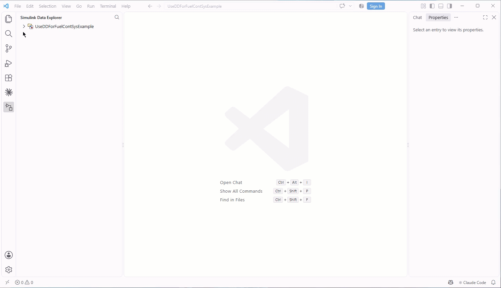

# Simulink Data Explorer Extension for Visual Studio Code

This extension provides support for viewing data from Simulink&reg; models and projects and editing Simulink data dictionaries and MAT-files in Visual Studio Code. It includes a hierarchical relationship tree that maps how your files reference each other, a table for browsing and editing file contents, and detailed properties for the selected data entries.

You can use this extension with or without MATLAB&reg; or Simulink installed on your system.



## Get Started

### Installation

You can install the extension from the
   [Visual Studio Code Marketplace](https://marketplace.visualstudio.com/items?itemName=mathworks.simulink-data-explorer):
   open the Extensions view (<kbd>Ctrl</kbd>/<kbd>Cmd</kbd>+<kbd>Shift</kbd>+<kbd>X</kbd>),
   search for *Simulink Data Explorer*, and click **Install**. Or, from the command line:

   ```sh
   code --install-extension mathworks.simulink-data-explorer
   ```


#### Optional: installation from a `.vsix`

To install a specific build by hand, for an air-gapped machine, or to
pick up a release before it reaches the Marketplace, download the `.vsix` file from the
[Releases page](https://github.com/mathworks/data-explorer-vscode/releases) and
install it by using the Extensions view → **⋯** menu → **Install from VSIX…**. Or, from the command line:

```sh
code --install-extension simulink-data-explorer-<version>.vsix
```


### Open Simulink Data Explorer

1. Open a folder or workspace that contains Simulink files.
2. Click the **Simulink Data Explorer** icon in the activity bar to see the relationship tree.
3. Open any supported file. The extension it opens in the Data Explorer table by default. Select a row to inspect it in the Properties panel.

## Features

### File Relationship Tree

The left pane organizes your data sources by folder, showing their hierarchical relationships. Supported files include:
- Simulink data dictionaries (SLDD and JSON files)
- Simulink models (SLX and MDL files)
- MAT files
- Projects (PRJ or TOML files)

Status markers indicate unresolved links and circular references.

### Data Viewer and Editor

The center table shows the contents of the selected data source in a searchable and filterable tree structured table. You can use the table to view the contents of model and project files, and to directly edit Simulink data dictionary files and MAT-files. When you select an entry in the table, the Properties panels shows a view only list of the full properties of the object. 

A value with two or more dimensions shows a short descriptor in its cell (for example, `<2x3x2 double>`). Click the grid icon next to the descriptor to show the whole array in a (view only) floating grid. A value with more than two dimensions includes a `(:,:,k)` page selector to step through its trailing dimensions. To edit the individual values, in the table, expand the **Value** node.

#### Search and Filter Data

You can explore and filter the data in the table by using the column headers or the search bar.
- To add a search condition to the table filters, type the condition in the search box and press <kbd>Enter</kbd>.
- To scope a condition to one column, right-click the column header, select a search operator, specify the search text, and click **Apply**. The scoped search operation is added to the search bar. You can also type scoped conditions directly into the search bar using the column name, operator, and search text. The operators include `:` (contains), `=`, `!=` (also `~=`), `>`, `<`, `>=` and `<=`. Examples include `Name:gain`, `Data Type=double`, and `Value>10`.
- To search every open data source, enter <kbd>Ctrl</kbd>/<kbd>Cmd</kbd>+<kbd>Alt</kbd>+<kbd>E</kbd>.

#### Synchronize Data Dictionary Edits with JSON Editor

A textual Simulink data dictionary (SLDD) file is backed by a JSON text document. To edit the JSON file using Visual Studio Code's built-in text editor, right-click the tab for the SLDD file and click **Reopen Editor With…** > **Text Editor**. Edits in the table and edits in the JSON file update each other automatically and there is a single shared undo history across both views.


## Supported Files

| Files | Formats | Support |
| --- | --- | --- |
| Simulink data dictionaries | `.sldd` JSON and compressed-binary | Read and write |
| Simulink models | `.slx`, `.mdl` | Read only |
| MAT-files | `.mat` Level 5 (`-v6`/`-v7`) | Read and write |
| MATLAB Projects | `.prj`, `matlab.toml` | Read only |

## Limitations

- Requires Visual Studio Code 1.106.0 or later.
- Editing supports Simulink data dictionary (SLDD) files and MAT-files. Simulink models and project files are read only.
- `.mat` support covers the Level 5 format only. **`-v7.3`** files, which are HDF5 and are required by MATLAB for variables above 2 GB, are not supported.
- Large textual (JSON) `.sldd` files are limited by size. Above **50 MB**, the file opens as a read only table. Above **512 MB**, the file opens in Visual Studio Code's text editor instead.
- Paste creates a new top level entry in the target section. Pasting as a child of a structure or bus is not supported.
- Reference resolution matches files by name (basename), preferring the referrer's own project or folder. Two project markers in the same directory are not supported.
- `.m` files are not scanned, so a project whose members are only `.m` files appears as an empty group, which is common for a `matlab.toml` project.
- A `matlab.toml` project page shows no member count and no label coverage fraction: that file records no member list, so each label is shown with the entries it declares instead. Clicking `matlab.toml` in the Visual Studio Code Explorer opens it in the text editor.

## Contact Us

We encourage all feedback. If you encounter a technical issue or have an enhancement request, create an issue here or contact MathWorks at support@mathworks.com.

## License

Distributed under the BSD 3-Clause License. See [LICENSE](LICENSE) for details.

Copyright 2026 The MathWorks, Inc.
